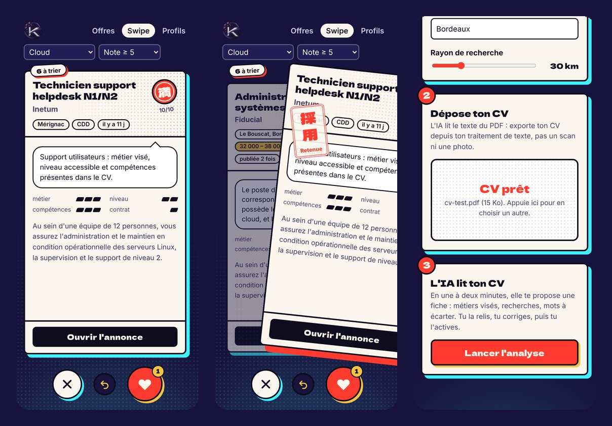
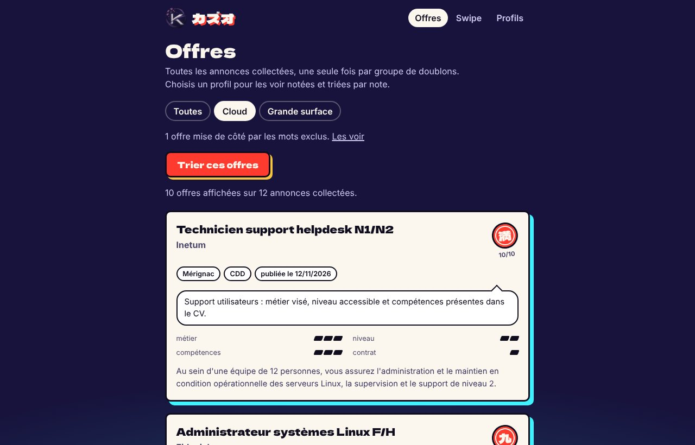
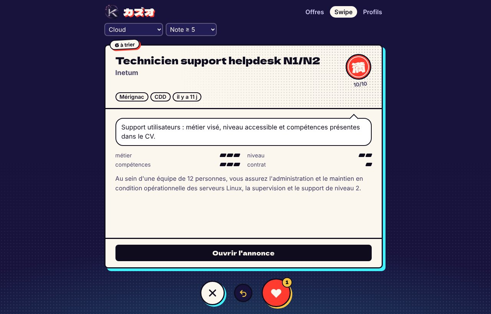

<p align="center">
  
</p>

<h1 align="center">Kazuo カズオ</h1>

<p align="center">
  <strong>Assistant de recherche d'emploi auto-hébergé.</strong><br>
  Il collecte les offres, les fait noter par une IA qui tourne chez moi, et me les présente en cartes à trier d'un geste.
</p>

---

Chaque matin à 7 h 30, Kazuo interroge les sources d'offres, élimine les doublons, puis demande à un modèle de langage local de noter chaque annonce sur 10 au regard de mon CV, avec une phrase d'explication. Je trie ensuite les offres sur mon téléphone : à droite je retiens, à gauche j'écarte.

Tout tourne sur un mini-PC sous **Proxmox VE**, dans des conteneurs LXC. Aucune donnée personnelle (CV, candidatures) ne part chez un fournisseur d'IA dans le cloud.



## Ce que fait Kazuo

| Étape | Fonctionnement |
|---|---|
| **Profils** | Je dépose un CV en PDF et je décris le poste visé. L'IA propose une fiche : métiers, recherches, mots à exclure, CV résumé. Je la relis et je l'active. Plusieurs profils peuvent coexister (« Réseau / Cloud », « Grande surface »…). |
| **Collecte** | Un timer systemd lance la collecte chaque matin sur l'API Adzuna, profil par profil. Un profil tout neuf est rattrapé sur 30 jours. |
| **Dédoublonnage** | Une empreinte (titre normalisé + entreprise + ville) regroupe les annonces publiées plusieurs fois. Je ne trie jamais deux fois la même offre. |
| **Notation** | L'IA juge 4 critères (métier, niveau, compétences, contrat) et le code calcule la note sur 10. Chaque note est accompagnée de son explication. |
| **Tri** | Une interface « swipe » pour téléphone, avec gestes tactiles, annulation, filtres par profil et par note. Une page Offres pour l'ordinateur. |
| **Candidatures** *(à venir)* | Lettre rédigée par l'IA à partir du vrai CV, relue et validée avant tout envoi. Suivi des réponses par IMAP. |



## Architecture

```
   iPhone ─── Tailscale (HTTPS) ───┐
   PC ─────── réseau local ────────┤
                                   ▼
┌──────────── CT 211 « kazuo » (LXC Debian 13, non privilégié) ────────────┐
│  kazuo.service        uvicorn :8000 : pages web + API + worker IA        │
│  kazuo-collect.timer  07:30 → collecte → mise en file des notations      │
│                                                                          │
│  SQLite (WAL)  /var/lib/kazuo/kazuo.db                                   │
│  offers · profiles · matches · llm_jobs                                  │
└───────────────┬──────────────────────────────────────────────────────────┘
                │ HTTP (réseau local)
                ▼
   CT 210 « ia » : Ollama, modèle gpt-oss:20b sur l'iGPU (Vulkan)

   Sorties Internet : API Adzuna (+ IMAP/SMTP à venir). Aucun port entrant ouvert.
```

| Brique | Rôle |
|---|---|
| **Proxmox VE** + conteneurs LXC non privilégiés | Isoler l'application (CT 211) et l'IA (CT 210) sur un mini-PC GMKtec K8 Plus |
| **FastAPI** + uvicorn (1 worker) | Pages HTML, API JSON et worker de la file d'IA dans un seul processus |
| **SQLite** en mode WAL | Toutes les données dans un fichier, migrations versionnées (`PRAGMA user_version`) |
| **Ollama** (gpt-oss:20b) | Analyse des CV, notation des offres, plus tard rédaction des lettres |
| **systemd** | Service durci, timer quotidien, journaux dans journald |
| **Jinja2** + JavaScript sans framework | Interface sans étape de build |

## Choix techniques, et pourquoi

### Une seule application, pas de services superflus
Un processus Python, une base SQLite, deux unités systemd. Pas de Redis, pas de Celery, pas de conteneur Docker en plus. Pour un usage personnel, chaque service ajouté est une chose de plus à mettre à jour, surveiller et sauvegarder.

### Une file d'attente persistante pour l'IA
Ollama traite **une requête à la fois**, et une notation prend une dizaine de secondes. Les tâches d'IA passent donc par une table `llm_jobs`, dépilée par un seul thread :
- **des priorités** : l'analyse d'un CV passe devant les 200 notations du matin ;
- **une prise de tâche atomique** (`UPDATE … RETURNING`) ;
- **jusqu'à 3 essais** si le modèle produit une réponse invalide ou tronquée ;
- **une reprise automatique** des tâches interrompues par un redémarrage ;
- **une mise en file idempotente**, et la recopie de la note des annonces identiques au lieu d'un nouvel appel à l'IA.

### Une notation explicable, reproductible et testée
Le modèle ne donne pas directement une note : il qualifie 4 critères avec des valeurs en clair (« métier visé », « un peu au-dessus de mon niveau »…). **Le code** calcule ensuite la note, avec des poids et des plafonds éliminatoires : un poste senior ne peut pas dépasser 3/10, quel que soit l'avis du modèle. Les critères sont stockés, ce qui permet de changer les poids et de tout recalculer sans rappeler l'IA.

Un **jeu de référence** de 15 offres réelles, avec leur note attendue, sert de test de non-régression après chaque modification du prompt. Dernier résultat : 15/15.

### Le prompt oriente, le code vérifie
Les sorties du modèle sont contraintes par un schéma JSON et validées par Pydantic. Les règles importantes sont garanties par le code, pas seulement demandées au modèle. Exemple : Adzuna exige que tous les mots d'une recherche figurent dans l'annonce, donc des recherches de 5 mots ne trouvent rien. Si l'IA en propose, le code retire les types de contrat et ne garde que les 3 premiers mots porteurs de sens.

### Exploitation avec systemd
- **Service durci** (`systemd-analyze security` : **1.9**) :
  - système de fichiers en lecture seule sauf le dossier de données (`ProtectSystem=strict`) ;
  - aucune capacité Linux ;
  - appels système filtrés (`SystemCallFilter`) ;
  - familles d'adresses réseau restreintes ;
  - `MemoryDenyWriteExecute` et `NoNewPrivileges`.
- **Un timer systemd plutôt qu'un ordonnanceur dans l'application.** `Persistent=true` rattrape une collecte manquée si la machine était éteinte. Les nouvelles tentatives sont gérées par systemd (`Restart=on-failure`), et tout se suit avec `systemctl list-timers` et `journalctl`.
- **Un coupe-circuit dans la collecte** : après deux erreurs réseau consécutives, elle s'arrête au lieu d'épuiser le quota de l'API. La connexion passe par un portail captif de résidence universitaire, qui coupe parfois.

### Sécurité et données personnelles
- **Le code, la configuration et les données sont séparés** selon la hiérarchie standard de Linux (FHS) : `/opt/kazuo` pour le code, `/etc/kazuo` pour la configuration, `/var/lib/kazuo` pour les données.
- **Les secrets** (clés d'API, mot de passe d'application) sont dans `/etc/kazuo/kazuo.env`, en droits `640 root:kazuo`, **hors du dépôt**. Ils sont masqués dans la représentation Python des réglages, donc jamais écrits dans un journal.
- **Le service tourne sous un utilisateur système dédié**, sans shell.
- **Aucun port entrant** : l'accès à distance passe par Tailscale, qui fournit le HTTPS et l'identité de l'utilisateur.
- **Rien n'est envoyé en mon nom sans validation explicite.**
- **Aucune automatisation de LinkedIn ni d'Indeed**, ce qu'interdisent leurs conditions d'utilisation. Seules des API officielles et des alertes e-mail sont utilisées.

### Une interface sans étape de build
- **Rendu côté serveur** avec Jinja2, avec échappement automatique.
- **Côté navigateur**, du JavaScript sans framework :
  - les « Pointer Events » gèrent la souris et le doigt avec le même code ;
  - l'interface est optimiste : la carte part tout de suite, l'enregistrement suit ;
  - les appels au serveur passent par une file, pour qu'une annulation n'arrive jamais avant la décision qu'elle annule ;
  - les textes des annonces sont toujours insérés avec `textContent`, jamais interprétés comme du HTML, pour éviter le XSS.
- **La police japonaise est hébergée sur le serveur et réduite** aux seuls caractères utilisés : 18 Ko au lieu de 2,5 Mo. La page n'envoie aucune requête vers Google et fonctionnera hors ligne.



## Quelques mesures

| Mesure | Valeur |
|---|---|
| Génération du modèle (gpt-oss:20b, iGPU) | environ 20 jetons/s |
| Notation d'une offre | environ 10 s |
| Réponses tronquées en production | 0 sur 1 116 notations |
| Offres collectées pour un nouveau profil (30 jours, Bordeaux + 30 km) | environ 270 |
| Jeu de référence de la notation | 15/15 |

## Installation, en résumé

Prérequis : Debian 13, Python 3, et une instance Ollama joignable.

```bash
useradd --system --home /var/lib/kazuo --shell /usr/sbin/nologin kazuo
install -d -o kazuo -g kazuo -m 750 /var/lib/kazuo
git clone https://github.com/ELGHUOST/kazuo.git /opt/kazuo
cd /opt/kazuo && python3 -m venv .venv && .venv/bin/pip install -r requirements.lock

install -d -m 750 -g kazuo /etc/kazuo
install -m 640 -g kazuo deploy/kazuo.env.example /etc/kazuo/kazuo.env   # puis renseigner les clés

cp deploy/kazuo.service deploy/kazuo-collect.service deploy/kazuo-collect.timer /etc/systemd/system/
systemctl daemon-reload && systemctl enable --now kazuo.service kazuo-collect.timer
```

## Feuille de route

| Phase | Contenu | État |
|---|---|---|
| 1 | Conteneur, squelette, source Adzuna, base, service durci | ✅ |
| 2 | Profils (CV → fiche proposée par l'IA → validation), collecte par profil | ✅ |
| 3 | Notation par l'IA, jeu de référence, collecte automatique du matin | ✅ |
| 4 | Interface swipe ✅ · accès distant Tailscale HTTPS · PWA · authentification | en cours |
| 5 | Lettres de motivation, relecture, envoi après validation | à venir |
| 6 | Suivi des réponses par IMAP | à venir |
| 7 | Sauvegardes, mises à jour, supervision | à venir |

## Structure du dépôt

```
app/
├── main.py · config.py · db.py (migrations) · dedup.py · web.py
├── sources/     API Adzuna, sonde de mesure des recherches
├── services/    collecte, notation, profils, jeu de référence, routine du matin
├── llm/         client Ollama (JSON contraint), file d'attente, tâches
├── routers/     API JSON et pages HTML
├── templates/   gabarits Jinja2
└── static/      thème CSS, police, icônes
deploy/          unités systemd, exemple de configuration
```

## Crédits

- Police **Dela Gothic One** sous licence SIL Open Font License (voir `app/static/fonts/OFL.txt`).
- Logo et interface : création originale pour ce projet.

Projet personnel, sans licence open source pour le moment : tous droits réservés.
